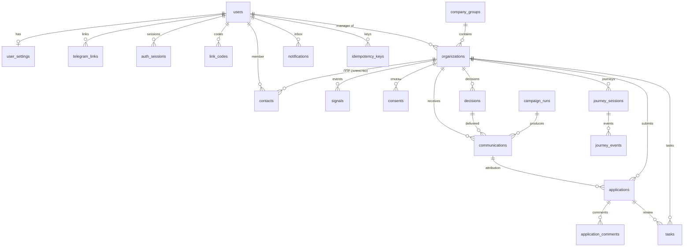

# Архитектура и модель данных

## Компоненты

| Компонент | Технологии | Ответственность |
|---|---|---|
| Mini App | React 19, TypeScript, Vite, Tailwind 4, React Router, TanStack Query | Интерфейс по ролям внутри Telegram и в браузере |
| API | FastAPI, Pydantic, SQLAlchemy 2 (async), Alembic | Авторизация, права, бизнес-логика, REST |
| Движок | Чистый Python (`app/engine`) | Скоринг, NBA, тексты, каналы, политика частоты, триггеры пути, план группы |
| Бот | aiogram 3 | Вход, push-предложения, статусы, задачи КМ, уведомления |
| Outbox | asyncio-задача в процессе API | Доставка уведомлений в Telegram с повторами |
| БД | PostgreSQL (prod), SQLite (локально и тесты) | Единое хранилище для Mini App и бота |

Бот работает в том же процессе и с той же БД, что и API: действие в боте сразу видно в Mini App, и наоборот.

## Решение оптимизатора

```
профиль (CRM, РКО, ИБ, история коммуникаций)
  → признаки: роль и её источник, структура группы, размер, отрасль, сезон (недели до пика), события, активность, отказы
  → скор = p × rev (AS IS) × K отрасли × K момента × K роли × K структуры × вес источника роли
  → событийные правила (валютный платёж, окончание депозита)
  → кому: роль ЛПР и маршрутизация (кредит — ЛПР, бухгалтеру — операционное)
  → как: канал и частота по активности; отказы — жёсткий фильтр
  → NBA: показать / email / передать КМ (задача) / уточнить роль / ничего не делать
```

Коэффициенты — в версии бизнес-правил (`rule_sets`), изменение создаёт новую версию, активна одна.
В A/B контрольная группа получает AS IS (тот же скор без новых признаков, общий текст, баннер каждому юрлицу).

## Политика коммуникаций (кампания)

- отказ от всех коммуникаций — ничего не отправляем (в обоих вариантах A/B);
- лимит по активности: высокая — 7 дн., средняя — 14 дн., email — не чаще 1 раза в 60 дн. при любой активности, КМ — 30 дн.;
- группа = один клиент: одно предложение на группу, лимит 7 дн. на всю группу;
- «стоп-кран»: 2 клика без заявки за 14 дней — продукт скрыт; скрытие баннера — пауза 30 дней;
- событийные предложения не ждут общего окна, но не повторяются чаще раза в неделю.

## Модель данных



Ключевые ограничения: уникальные email, ИНН, Telegram ID, номер заявки, `dedupe_key` задачи, пара (организация, канал)
в согласиях, (пользователь, scope, ключ) в идемпотентности; CHECK на перечисления статусов и ролей, сумму > 0, срок 1–360,
активность ≥ 0. Внешние ключи с `CASCADE` для зависимых данных и `SET NULL` для ссылок на пользователей.
Дополнительно: `status_changes` (история статусов заявок и задач), `audit_events` (журнал), `processed_updates`
(дедупликация Telegram update), `rule_sets` (версии правил).

## Права доступа

| Роль | Организации | Заявки | Задачи | Правила, кампании |
|---|---|---|---|---|
| client | только свои (через `contacts.user_id`) | свои, без внутренних комментариев; отмена, ответ на уточнение | — | — |
| manager | свой портфель (`organizations.manager_id`) | портфель: статусы, назначение на себя, комментарии | свои и неназначенные в портфеле | — |
| analyst | все | чтение | чтение и создание | да |
| admin | все | все | все | да + пользователи и аудит |

Проверка — в сервисном слое (`services/access.py`): запросы фильтруются областью видимости, недоступная запись отвечает 404.

## Telegram

- Вход в Mini App: `initData` → `POST /api/auth/telegram` → проверка HMAC-SHA256 (`WebAppData` + токен бота), срок
  `auth_date`, пользователь по `telegram_links` → Bearer-токен. Непривязанный аккаунт — 403 `telegram_not_linked` → онбординг.
- Привязка: одноразовый код из профиля (`t.me/<бот>?start=<код>`), вход по email в Mini App, демо-роль (только `DEMO_MODE`).
- Вебхук: `POST /api/telegram/webhook` с заголовком `X-Telegram-Bot-Api-Secret-Token`.
- Повторы update: таблица `processed_updates` (вставка до обработки; конфликт — пропуск).
- Уведомления: запись в `notifications` (веб) + `tg_status=pending`, если пользователь привязан и не отключил этот тип;
  outbox атомарно «захватывает» запись, отправляет, при сбое — повтор с экспоненциальной задержкой (до 5 попыток),
  при блокировке бота — `failed` без повторов.

## Метрики пилота

CR в заявку, CTR, просмотр → сделка (одобренные заявки, атрибутированные к коммуникации), Time to Action (медиана от показа
до заявки), отписки и скрытия, сообщений на группу в неделю, UX-метрики пути (доля дошедших до заявки, время до заявки,
drop-off калькулятор → заявка, закрытые подсказки), z-тест разницы CR. Рандомизация — на уровне группы компаний.
